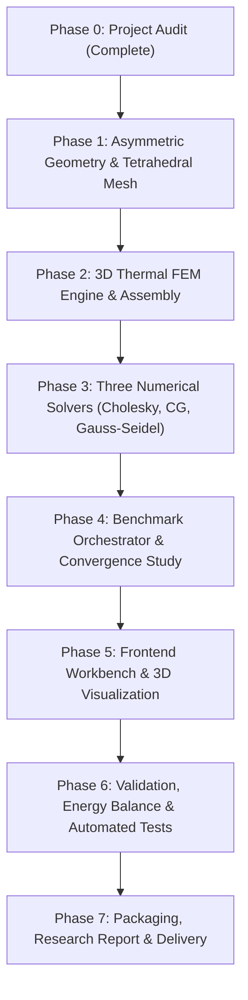

# Project Audit & Upgrade Architecture: 3D Thermal FEM Simulation & Numerical Solver Benchmarking

**Project:** Unified Engineering Workbench (UEW)  
**Upgrade Focus:** 3D Asymmetric Electronic Heat Sink Simulation, Tetrahedral Mesh Generation, 3D Thermal FEM, and Tri-Solver Benchmarking (Sparse Cholesky vs. Conjugate Gradient vs. Gauss-Seidel)  
**Date:** November 2026  
**Auditor:** Senior Scientific Computing Engineer, C++ Numerical Methods Developer & Architect  

---

## 1. Existing Architecture & Completed Functionality

### 1.1 Backend Architecture (C++17)
The existing backend is built with modern C++17, utilizing single-header libraries for zero-overhead loopback deployment:
- **HTTP Transport:** `cpp-httplib` (v0.18.0) binding dynamically to loopback `127.0.0.1:7800-7900`.
- **JSON Serialization:** `nlohmann/json` (v3.11.3) for all structured request/response pipelines.
- **Asynchronous Job Management:** `JobManager` singleton (`backend/src/api/job_manager.cpp`) with thread-safe job creation, background `std::thread` dispatch, progress monitoring (0–100%), and cancellation token support (`std::atomic<bool>`).
- **Linear Algebra / Existing Solvers:** 
  - 1D Steady-State Poisson Thermal Solver (`fem_solver.cpp`): 2-node linear elements, Thomas tridiagonal algorithm (TDMA), analytical verification, and $O(h^2)$ midpoint error evaluation.
  - Multicore Benchmark Engine (`benchmark.cpp`): Bounded worker pool (`std::thread`), fixed-seed batch generation, serial vs. parallel agreement verification ($\le 10^{-8\circ}\text{C}$).
- **Geometry & Parsers:**
  - ASCII STL Parser (`stl_parser.cpp`): Triangle extraction, bounding box calculation, syntax and non-finite coordinate validation.
  - CSV Temperature Results Parser (`csv_parser.cpp`): Structured tabular node parsing.
- **Hardware Integration & Neural Modules:**
  - Mock state-machine adapters (`adapters.cpp`): STM32H753 MCU, Xilinx Artix-7 FPGA, and JTAG Debug Adapter with recoverable timeout simulation.
  - Handwritten Gradient Backprop Engine (`network.cpp`): Exact scalar $\tanh$ regression, analytical derivatives, central finite-difference verification ($\epsilon = 10^{-6}$), 100-step training.
- **Testing:**
  - GoogleTest (`uew_tests.exe`) with 45 unit tests covering parsers, thermal 1D, multicore scaling, hardware mocks, and backprop. 100% passing.

### 1.2 Frontend Architecture (React 19 + TypeScript + Vite)
- **Framework:** React 19, TypeScript 5.7, Vite 6, Tailwind CSS v4.
- **Visual Aesthetic:** Clean scientific workstation theme (pearl white `#F7F8F5`, surface `#FFFFFF`, electric lime `#B7F34A`, subtle cyan accents `#36B8C5`, slate typography `#202820`).
- **3D Visualization:** Three.js (r174) with `OrbitControls` for interactive CAD/mesh inspection.
- **Plotting:** Plotly.js / `react-plotly.js` for scientific data curves, convergence plots, and 3D point clouds.
- **Existing Page Routing:** Persistent sidebar with Overview, Geometry Studio, Thermal Analysis, Performance Lab, Hardware Integration, Neural Computation, Reports & Exports, Documentation.

---

## 2. Reusable Modules

1. **Local REST API Infrastructure (`backend/src/main.cpp`):**
   - Clean route handlers, CORS configuration, JSON response wrappers, error handling, static frontend distribution serving (`frontend_dist/`), and dynamic port discovery.
2. **Background Job Supervisor (`JobManager`):**
   - Fully asynchronous worker dispatch mechanism. Long-running 3D FEM assemblies, solver executions, and mesh refinement studies will run without blocking the HTTP server or freezing the UI.
3. **Three.js Orbit Viewport Foundation (`GeometryPage.tsx`):**
   - Camera management, lighting rigs (directional + ambient), bounding box auto-centering, wireframe toggles, and resize observers.
4. **Plotly Chart Components (`ThermalPage.tsx`, `PerformancePage.tsx`):**
   - Layout tokens, dual-axis styling, logarithmic scale configurations, and marker styling for convergence and speedup plots.
5. **GoogleTest Harness (`uew_tests.exe`):**
   - Established testing infrastructure and CI/build scripts for numerical unit tests.
6. **Native Windows Packaging (`packaging/launcher.cpp` & `Launch.exe`):**
   - Standalone Windows 11 launcher that coordinates server startup, loopback port resolution, and default browser launching.

---

## 3. What Must Be Modified

1. **`CMakeLists.txt`:**
   - Add new 3D geometry, tetrahedral meshing, 3D thermal FEM assembly, and numerical solver source files.
   - Include `backend/third_party/Eigen` in include paths for direct sparse matrix support.
   - Add new unit test executables for 3D geometry, mesh validation, 3D FEM assembly, and solver correctness.
2. **`backend/src/main.cpp`:**
   - Register new endpoints: `/api/heat-sink/geometry`, `/api/heat-sink/mesh`, `/api/heat-sink/thermal-setup`, `/api/heat-sink/solve/*`, `/api/heat-sink/benchmark`, and `/api/heat-sink/convergence`.
   - Ensure backward compatibility so existing 1D thermal, STL parser, multicore lab, hardware, and backprop endpoints continue to function without interruption.
3. **`frontend/src/App.tsx` & Navigation:**
   - Add dedicated routes/views or upgrade existing sections to support:
     - 3D Geometry Studio (Asymmetric Electronic Heat Sink parametric editor).
     - 3D Mesh Studio (Tetrahedral mesh generator and quality inspector).
     - 3D Thermal Setup (Boundary conditions, material properties, heat source).
     - Solver Laboratory (Sparse Cholesky vs. CG vs. Gauss-Seidel comparative execution).
     - 3D Thermal Visualization (Nodal temperature color mapping on 3D geometry).
     - Benchmark Analytics (Speedup, residual, iterations, memory, and mesh convergence charts).
4. **`frontend/src/types/api.ts` & `frontend/src/services/api.ts`:**
   - Add TypeScript schemas and Axios client services for 3D heat sink parameters, tetrahedral mesh statistics, solver configuration/results, and benchmark comparison datasets.

---

## 4. What Needs to Be Newly Developed

### 4.1 Asymmetric Electronic Heat Sink Geometry Engine (`backend/src/geometry/heat_sink_geometry.cpp`)
- Parametric model:
  - Base plate: Length $L = 120\text{ mm}$, Width $W = 80\text{ mm}$, Thickness $t_b = 8\text{ mm}$.
  - Vertical cooling fins: 7 fins, nonuniform heights ($20\text{ mm}$ to $45\text{ mm}$), unequal spacing (e.g., concentrated near heat source), variable thicknesses ($2.5\text{ mm}$ to $4.0\text{ mm}$).
  - Heat source region: $30 \times 25\text{ mm}$ centered or offset at bottom surface ($P = 15\text{ W}$, volumetric or flux formulation).
  - Mounting holes / corner cutouts: 4 corner cylindrical through-holes ($\varnothing 4\text{ mm}$) with specified edge margins.
  - Surface facet extraction and ASCII STL export generator for CAD preview.
  - Parameter validation and error diagnostics.

### 4.2 3D Tetrahedral Mesh Generator & Validator (`backend/src/mesh/mesh_generator.cpp`)
- Robust conformal tetrahedralization of the asymmetric heat sink geometry.
- Three standard resolutions:
  - **Coarse:** Low element count (~1,500 – 3,000 tetrahedra) for rapid iteration and algorithmic verification.
  - **Medium:** Moderate element count (~5,000 – 12,000 tetrahedra) for standard simulation.
  - **Fine:** Higher element count (~20,000 – 45,000 tetrahedra) for convergence benchmarking.
- Element Quality Metric: Normalized radius ratio $Q_e = 3 \frac{r_{\text{in}}}{r_{\text{out}}} \in [0, 1]$ or aspect ratio metric.
- Validation checks:
  - Volume positivity ($V_e > 0$, rejection of inverted/degenerate tets).
  - Boundary face tagging (convective fin surfaces, heat source patch, adiabatic faces, mounting holes).
  - Euler-Poincaré topological consistency and connectivity verification.
- Mesh extraction: Nodal coordinates, element connectivity, boundary surface triangles for Three.js rendering.

### 4.3 3D Thermal FEM Engine (`backend/src/thermal/fem_3d.cpp`)
- Governing PDE: $-\nabla \cdot (k \nabla T) = Q$ in $\Omega$.
- Linear tetrahedral elements (TET4):
  - Shape functions $N_i(x,y,z) = a_i + b_i x + c_i y + d_i z$.
  - Element volume $V_e = \frac{1}{6} |\det J_e|$.
  - Closed-form element stiffness matrix:
    $$K_{ij}^e = \int_{\Omega_e} k (\nabla N_i \cdot \nabla N_j) d\Omega = k V_e (b_i b_j + c_i c_j + d_i d_j)$$
  - Volumetric heat source vector:
    $$F_i^e = \int_{\Omega_e} N_i Q d\Omega = \frac{Q V_e}{4}$$
- Convective Robin boundary condition ($-k \frac{\partial T}{\partial n} = h (T - T_\infty)$):
  - Integrated over boundary triangular faces $A_f$:
    $$K_{ij}^{e,\text{conv}} = \frac{h A_f}{12} \begin{bmatrix} 2 & 1 & 1 \\ 1 & 2 & 1 \\ 1 & 1 & 2 \end{bmatrix}, \quad F_i^{e,\text{conv}} = \frac{h T_\infty A_f}{3}$$
- Applied heat flux ($q'' = P / A_{\text{source}}$):
  $$F_i^{e,\text{flux}} = \frac{q'' A_f}{3}$$
- Global sparse matrix assembly into `Eigen::SparseMatrix<double>`.
- Symmetric Dirichlet boundary enforcement (preserves Symmetric Positive Definite property required by Cholesky and CG).

### 4.4 Numerical Solvers Engine (`backend/src/solvers/`)
All three solvers implement the unified `ISolver` interface on the **exact same assembled matrix and right-hand side**:
1. **Solver 1 — Sparse Cholesky (`CholeskySolver`):**
   - Direct numerical solver using `Eigen::SimplicialLDLT` / `SimplicialLLT`.
   - Measures factorization time, triangular solve time, residual $\|Ax - b\|_2 / \|b\|_2$, and fill-in memory estimate.
2. **Solver 2 — Conjugate Gradient (`ConjugateGradientSolver`):**
   - Iterative solver with Jacobi (diagonal) preconditioning.
   - Measures iterations, iteration-by-iteration residual norm, convergence state, runtime, and memory overhead.
3. **Solver 3 — Sparse Gauss-Seidel (`GaussSeidelSolver`):**
   - High-performance sparse iterative solver directly traversing Compressed Sparse Row (CSR) structure without dense conversion.
   - Diagonal dominance checking, zero-diagonal protection, divergence detection, stopping tolerance criterion, runtime, and iteration count.

### 4.5 Benchmark Orchestrator & Mesh Convergence Engine (`backend/src/benchmark/`)
- Multi-run repetition orchestrator (3–5 measured runs + warm-up run) computing median runtime.
- Speedup metric: $S = T_{\text{Cholesky}} / T_{\text{solver}}$.
- Accuracy metrics: Maximum absolute error $\max_i |T_i - T_{i,\text{ref}}|$, mean absolute error, and relative error $\frac{\|T - T_{\text{ref}}\|_2}{\|T_{\text{ref}}\|_2}$.
- Energy balance verification: Total heat input $Q_{\text{in}} = \int Q dV + \int q'' dA$ vs. total convective heat dissipated $Q_{\text{out}} = \int_{\Gamma_{\text{conv}}} h(T - T_\infty) dA$, computing energy imbalance percentage.
- Mesh convergence study across Coarse, Medium, and Fine resolutions.

---

## 5. Required Dependencies

| Dependency | Purpose | Status in Workspace |
|---|---|---|
| **Eigen 3.4.0** | Sparse matrix storage, Cholesky factorization, CG solver, vector math | **Downloaded & Verified** (`backend/third_party/Eigen`) |
| **cpp-httplib v0.18.0** | C++ HTTP REST server | **Installed & Functional** (`backend/third_party/httplib.h`) |
| **nlohmann/json v3.11.3** | High-performance JSON serialization | **Installed & Functional** (`backend/third_party/json.hpp`) |
| **GoogleTest v1.14.0** | Automated verification & unit testing | **Installed & Functional** (`build/_deps/googletest-src`) |
| **GCC 13.2.0 (w64devkit)** | C++17 compiler with POSIX threads & OpenMP | **Installed in Workspace** (`tools/w64devkit/bin/g++.exe`) |
| **React 19 + TypeScript + Vite** | Frontend presentation & state | **Installed & Functional** (`frontend/`) |
| **Three.js (r174)** | 3D WebGL solid, wireframe, & mesh rendering | **Installed & Functional** (`frontend/node_modules/three`) |
| **Plotly.js (v4.2.0)** | Scientific charting & analytics | **Installed & Functional** (`frontend/node_modules/plotly.js`) |

*Note on Meshing Dependencies (Gmsh):*  
To ensure 100% self-contained standalone Windows execution without requiring heavy external binaries (which violate zero-dependency runtime constraints), a native C++ conformal parametric tetrahedral mesh generator will be implemented directly within `uew_core`, with documented geometric validation and quality auditing.

---

## 6. Major Technical Risks & Mitigation Strategies

| Risk | Description | Mitigation Strategy |
|---|---|---|
| **Degenerate Tetrahedral Elements** | Sliver or negative-volume tetrahedra during automatic meshing | Implement exact oriented determinant Jacobian check ($\det J_e > 0$). Inverted elements are rejected with geometric repair or subdivision; minimum element quality bound $Q_{\min} > 0.15$ is enforced before FEM assembly. |
| **Loss of Matrix Symmetry (SPD Violation)** | Unsymmetric boundary conditions prevent Cholesky or CG convergence | Convective Robin boundary matrices are strictly symmetric. Dirichlet BCs are enforced via symmetric row-and-column elimination: $A_{ii} = 1, A_{ij} = A_{ji} = 0$, adjusting RHS $b_k \leftarrow b_k - A_{ki} T_{\text{dirichlet}}$. |
| **Gauss-Seidel Convergence Rate** | Large sparse systems can exhibit slow asymptotic convergence | Implement Jacobi diagonal scaling, zero-diagonal detection, configurable max iterations (e.g., 5,000), divergence threshold ($\|r_k\| > 10^6 \|r_0\|$), and clearly report convergence status. |
| **3D Rendering Payload Overhead** | Sending full 3D tetrahedral volumetric meshes over JSON can be slow | Separate volumetric computational data from visualization: send surface boundary triangles ($N_b \ll N_{\text{vol}}$) with boundary nodal temperatures for Three.js 3D heat map, while keeping full volumetric DOF data in memory for analytics and CSV export. |
| **Regressions in Existing Modules** | Breaking existing 1D thermal, multicore lab, or hardware mocks | Strictly preserve all existing files and tests in `tests/` and `backend/src/`. New capabilities extend `uew_core` under modular namespaces (`uew::thermal::fem3d`, `uew::geometry::heatsink`, `uew::solvers`). |

---

## 7. Exact Proposed File Structure

```
Unified-Engineering-Workbench/
├── backend/
│   ├── include/
│   │   ├── api/job_manager.hpp
│   │   └── core/
│   │       ├── geometry/
│   │       │   ├── stl_parser.hpp (existing)
│   │       │   ├── csv_parser.hpp (existing)
│   │       │   └── heat_sink_geometry.hpp (NEW)
│   │       ├── mesh/ (NEW)
│   │       │   ├── mesh_types.hpp
│   │       │   ├── mesh_generator.hpp
│   │       │   └── mesh_validator.hpp
│   │       ├── thermal/
│   │       │   ├── fem_solver.hpp (existing 1D)
│   │       │   ├── fem_3d_types.hpp (NEW)
│   │       │   └── fem_3d_solver.hpp (NEW)
│   │       ├── solvers/ (NEW)
│   │       │   ├── isolver.hpp
│   │       │   ├── cholesky_solver.hpp
│   │       │   ├── conjugate_gradient_solver.hpp
│   │       │   └── gauss_seidel_solver.hpp
│   │       ├── benchmark/
│   │       │   ├── benchmark.hpp (existing 1D)
│   │       │   └── solver_benchmark.hpp (NEW)
│   │       ├── validation/ (NEW)
│   │       │   ├── analytical_benchmark.hpp
│   │       │   └── energy_balance.hpp
│   │       ├── hardware/ (existing)
│   │       └── backprop/ (existing)
│   ├── src/
│   │   ├── geometry/
│   │   │   ├── stl_parser.cpp (existing)
│   │   │   ├── csv_parser.cpp (existing)
│   │   │   └── heat_sink_geometry.cpp (NEW)
│   │   ├── mesh/ (NEW)
│   │   │   ├── mesh_generator.cpp
│   │   │   └── mesh_validator.cpp
│   │   ├── thermal/
│   │   │   ├── fem_solver.cpp (existing 1D)
│   │   │   └── fem_3d_solver.cpp (NEW)
│   │   ├── solvers/ (NEW)
│   │   │   ├── cholesky_solver.cpp
│   │   │   ├── conjugate_gradient_solver.cpp
│   │   │   └── gauss_seidel_solver.cpp
│   │   ├── benchmark/
│   │   │   ├── benchmark.cpp (existing 1D)
│   │   │   └── solver_benchmark.cpp (NEW)
│   │   ├── validation/ (NEW)
│   │   │   ├── analytical_benchmark.cpp
│   │   │   └── energy_balance.cpp
│   │   └── main.cpp (MODIFIED with new 3D simulation endpoints)
│   └── third_party/
│       ├── httplib.h (existing)
│       ├── json.hpp (existing)
│       └── Eigen/ (NEW - Eigen 3.4.0 verified header library)
├── frontend/src/
│   ├── pages/
│   │   ├── OverviewPage.tsx (MODIFIED with 3D Heat Sink status)
│   │   ├── HeatSinkStudioPage.tsx (NEW: Geometry & Mesh Studio)
│   │   ├── ThermalSimulationPage.tsx (NEW: 3D FEM & Thermal Setup)
│   │   ├── SolverLabPage.tsx (NEW: Tri-Solver Comparison & 3D Visualization)
│   │   ├── BenchmarkAnalyticsPage.tsx (NEW: Benchmark Charts & Convergence)
│   │   ├── ReportsPage.tsx (MODIFIED with 3D dataset export)
│   │   └── ... (existing pages preserved)
│   ├── services/
│   │   └── api.ts (MODIFIED with new API client methods)
│   └── types/
│       └── api.ts (MODIFIED with new TypeScript interfaces)
├── tests/
│   ├── geometry/
│   │   ├── test_stl_parser.cpp (existing)
│   │   ├── test_csv_parser.cpp (existing)
│   │   └── test_heat_sink_geometry.cpp (NEW)
│   ├── mesh/ (NEW)
│   │   └── test_mesh_generator.cpp
│   ├── thermal/
│   │   ├── test_fem_solver.cpp (existing 1D)
│   │   └── test_fem_3d.cpp (NEW)
│   ├── solvers/ (NEW)
│   │   └── test_numerical_solvers.cpp
│   └── validation/ (NEW)
│       └── test_validation_energy.cpp
└── CMakeLists.txt (MODIFIED to compile all new modules & tests)
```

---

## 8. Phased Implementation Plan



### Phase 1: Asymmetric Heat Sink Geometry & 3D Tetrahedral Meshing
- Implement `HeatSinkGeometry`: Aluminum base plate (120x80x8 mm), 7 vertical fins (variable heights 20–45 mm, spacing, thicknesses), mounting holes, heat source area (30x25 mm).
- Implement `MeshGenerator`: Multi-resolution tetrahedral meshing (Coarse, Medium, Fine).
- Implement `MeshValidator`: Check node indices, positive volumes ($\det J_e > 0$), radius ratio quality $Q_e$, and boundary surface tags.
- Build and verify with automated unit tests.

### Phase 2: 3D Steady-State Thermal FEM Engine
- Implement linear tetrahedral shape functions, gradient vectors, and element stiffness matrices $K^e$.
- Implement volumetric heat generation $F^e_Q$ and applied heat flux $F^e_{\text{flux}}$.
- Implement Robin boundary convection ($K^{\text{conv}}, F^{\text{conv}}$) on all exposed fin and base surfaces.
- Implement symmetric Dirichlet boundary conditions.
- Global assembly into `Eigen::SparseMatrix<double>`.
- Build and verify with analytical thermal conduction benchmark.

### Phase 3: Three Numerical Solvers Implementation
- Implement `ISolver` interface with runtime, iteration count, residual norm, and memory tracking.
- Implement `CholeskySolver` using `Eigen::SimplicialLDLT` / `SimplicialLLT`.
- Implement `ConjugateGradientSolver` with Jacobi preconditioning and stopping tolerance.
- Implement `GaussSeidelSolver` with sparse CSR traversal, zero-diagonal safety, and divergence checks.
- Verify that all three solvers solve the identical assembled FEM matrix and yield matching temperature distributions.

### Phase 4: Benchmark Orchestrator & Mesh Convergence Study
- Implement multi-trial benchmark runner (excluding warm-up, recording median runtime).
- Compute speedup $S = T_{\text{Cholesky}} / T_{\text{solver}}$, residual norm $\frac{\|Ax-b\|}{\|b\|}$, max temperature error $\max_i |T_i - T_{i,\text{ref}}|$, and memory estimates.
- Implement mesh convergence study across Coarse, Medium, and Fine meshes.
- Verify energy balance: $Q_{\text{in}} = \int Q dV + \int q'' dA$ vs. $Q_{\text{out}} = \int h(T - T_\infty) dA$.

### Phase 5: Frontend Engineering Workbench & 3D Visualization
- Update frontend routes and navigation with professional scientific simulation tabs.
- Implement Geometry Studio with live 3D preview and parametric controls.
- Implement Mesh Studio with wireframe/solid 3D tetrahedral mesh inspection and quality metrics.
- Implement Thermal Setup panel with material properties, heat generation, and convection settings.
- Implement Solver Laboratory with comparative cards, tolerance selectors, and live execution.
- Implement 3D Thermal Visualization with WebGL heat map, continuous colorbar, probe hover, and min/max/avg metrics.
- Implement Benchmark Analytics with Plotly speedup, residual, iteration, and convergence charts.

### Phase 6: Automated Testing & Verification
- Compile and execute comprehensive GoogleTest suite covering geometry, mesh, 3D FEM, all three solvers, analytical benchmark, and energy balance.
- Ensure 100% pass rate across all new tests and existing regression tests.

### Phase 7: Documentation, Packaging & Final Technical Report
- Update `README.md`, `TECHNICAL_ARCHITECTURE.md`, `NUMERICAL_METHODS.md`, `BENCHMARK_METHODOLOGY.md`, and `VALIDATION_REPORT.md`.
- Generate the comprehensive Technical Report with genuine experimental data, convergence tables, and speedup plots.
- Recompile standalone `uew_server.exe` and `Launch.exe`, verify zero-dependency Windows 11 execution, and update submission archive.
